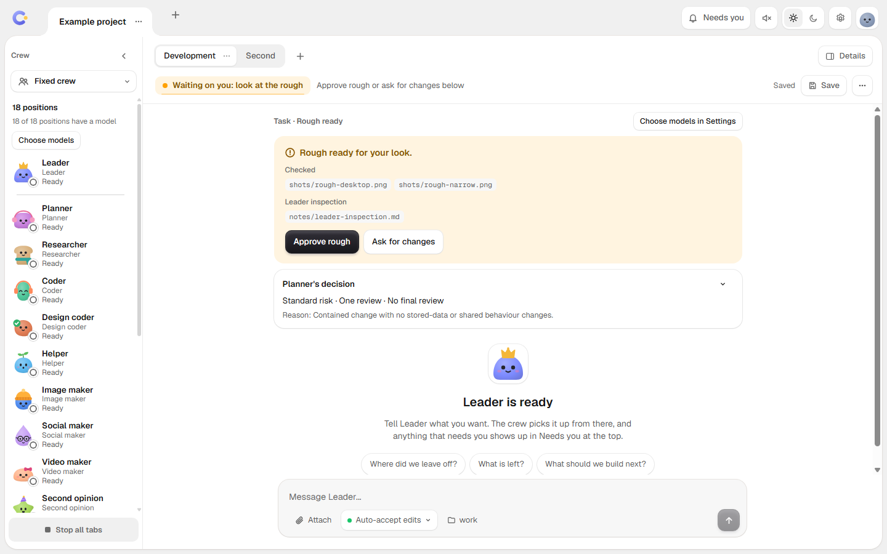

<div align="center">

# Command Center

**Run a crew of AI coding agents from one window.**
A leader talks with you, a fixed crew of 18 positions plans, builds and reviews, and you choose how much it may do without asking.




</div>

## What it is

Command Center is local mission control for the AI coding tools you already use. You talk to one **leader**. Every tab has the same fixed crew of 18 positions: Leader, Planner, Researcher, Coder, Design coder, Helper, Image maker, Social maker, Video maker, Second opinion, two Reviewer and Fixer pairs, Final reviewer, Design final reviewer, Minimal fixer and Minimal reviewer. There is nothing to build: you only choose which AI model sits in each position, and a position with no model is not used. The Planner decides how risky the work is and which reviews it needs, the leader launches the positions the plan calls for, and you approve the plan (and, for anything you can see or try, a rough version) before the work goes on. Everything runs on your own PC and talks only to the agent tools you have installed and signed in.

## Features

- **One leader, one fixed crew per tab.** Projects hold tabs, and each tab owns its folder, its 18 positions and its leader chat. A new tab is initially saved with all 18 positions unassigned unless choices or Auto assign were requested. Startup and CLI discovery fill empty automatic choices from installed tools; positions cleared by you stay empty.
- **Any CLI in any position.** Each position can run on Claude Code, Codex or OpenCode, and any other agent CLI that speaks the Agent Client Protocol (ACP, such as `opencode acp`) can be added in Settings. Command Center is not tied to one vendor.
- **Pick a model per position, or let it assign.** In **Settings > Crew and models** you choose a model and effort for each position by hand, or press **Auto assign** to fill them from the AI tools you have installed (empty positions are also filled this way when the app starts and after it re-checks your tools; a position you cleared by hand stays empty). **Use one model for all positions** changes idle positions together; the result names any busy positions it skipped. Your choices are saved per tab, so two tabs can use different models. There is no crew or template editor and no tagging of seats: the leader launches the right position when the plan needs it.
- **The Planner decides the process.** The plan records the risk level and which reviews the work needs (a final review is required for high or unknown risk, large work and work that joins several parts). You approve the plan, and for visible work you try and approve a rough version before polish, checks and review. A review should come from a different model than the one that wrote the code; when the same model or company sits on both, Settings says so, but it does not block you.
- **You stay in charge.** Approval cards for risky steps, permission modes per tab (Ask before edits, Auto-accept edits, Plan only, Bypass permissions) and a "Needs you" inbox.
- **Safety limits.** A launch budget, stall detection, leftover-process cleanup, and the app's own connection tokens kept out of the chat.
- **Live view.** Streaming chat, live run logs, usage and context numbers, Stop per tab or Stop all.
- **Pick up where you left off.** Save writes a handover file the next leader session reads.
- **Desktop or browser.** Run it as a desktop app or open it in your browser on localhost.

## Quick start

You need Windows, [Node 24](https://nodejs.org) or newer, and at least one of Claude Code, Codex or OpenCode installed and signed in.

```sh
# clone this repository, then in its folder:
npm install
npm run app      # desktop window
# or: npm start  # then open the printed http://127.0.0.1:4317/#key=... address
```

Build a portable exe with `npm run dist` (it still needs Node 24 on the machine).

## How it works

Every tab has the same fixed crew, and its work moves through a saved task in this order:

1. **Plan.** The Planner writes the plan: what changes, which files and callers it touches, the risk level and which reviews are needed. You approve it, and a changed plan needs your approval again.
2. **Rough.** For anything you can see or try, a rough version comes first and you approve it before any polish or review.
3. **Build and checks.** The leader launches the Coder (or the Design coder or another maker) and the checks the plan lists are run.
4. **Review and fixes.** A Reviewer checks the work, each finding is sorted into fix or pass, and a Fixer fixes what must be fixed. A second Reviewer and Fixer pair and the Final reviewer follow when the plan needs them.
5. **Ship.** Commit, push and publish are part of the plan and only happen when it names them.

A position with no model cannot run: the launch is refused with a message telling you to choose one in Settings. Anything that needs you lands in **Needs you**.

## Privacy and safety

- The server binds to `127.0.0.1` only. The live connection and every change need a per-launch key; loading the page and its images does not.
- No telemetry. Command Center sends nothing anywhere; the agent CLIs talk to their own providers as they normally do.
- Each tab picks a permission mode, from **Ask before edits** (the leader asks before edits, commands and launching seats that can write; a Codex leader asks only about commands Codex judges unsafe) to **Bypass permissions** (runs everything without asking). The mode picker says what each mode does for that tab's CLI. ACP leaders always run in full access, and an ACP CLI on a crew seat needs your confirmation once.
- No CLI's read-only mode is treated as a real boundary.

See [SECURITY.md](./SECURITY.md) to report a problem.

## Contributing

Issues and pull requests are welcome. See [CONTRIBUTING.md](./CONTRIBUTING.md).

## Licence

MIT, see [LICENSE](./LICENSE).

Not affiliated with Anthropic, OpenAI or the other tools named. Their logos are trademarks of their owners.

---

# Reference

A workspace contains projects, each project contains tabs, and each tab owns its folder, its fixed crew choices, its task, runs, and leader conversation.

## Install & run

```sh
npm install
npm start
```

The server opens on `http://127.0.0.1:4317` and binds to localhost only. `npm start` prints one line, `Open http://127.0.0.1:4317/#key=<key>`: open that exact address, because the page needs the key to connect (every connection and every upload needs it; see `PROTOCOL.md` "App key"). To open the Electron desktop shell, run `npm run app`; Electron makes the key itself.

## Packaged .exe

`npm run dist` builds a portable exe in a per-run staging directory, checks that exact app/exe pair with `scripts/packaged-smoke.mjs`, then publishes the verified build. The smoke starts the exe without a window, waits for server readiness, requests `GET /`, and checks that the server and exe exit. It also runs the copied server with Node outside the repository to catch missing packaged imports.

For separate checks, build to a fresh output folder outside `dist/`. The exe must sit beside `win-unpacked`:

```sh
npx electron-builder --config.directories.output="<output>"
npm run dist:smoke -- "<output>/win-unpacked/resources/app" "<output>/Command Center.exe"
npm run dist:proof -- "<output>/win-unpacked/resources/app" "<output>/Command Center.exe"
```

The checks reject an app/exe pair from different builds and the published `dist/` pair. `npm run dist` removes its staging artifacts after verification. The smoke verifies startup, not whether the agent CLIs are installed. Builds are locked, and publication happens only after the staged build passes. A failed build quarantines its own exe and puts the last verified exe back over a current one that differs from it (if there is no last verified exe, the current one is left untouched); the next build removes that quarantined exe. A build that runs over 20 minutes or a smoke over 5 is stopped with all its child processes and counts as a failure.

The exe is not self-contained. It starts `node server/index.ts` as a child process, so Node 24 must be installed on the machine running it. `asar` is disabled because Node executes the packaged server from regular files under `resources/app/`.

The portable app unpacks to a fresh temp folder each launch, so packaged data lives under `%APPDATA%\command-center`. Electron passes that directory as `CC_DATA_DIR` only for packaged runs. Source runs keep config, logs, chats, and scratch files in the repository. On first packaged launch the app starts on one empty example project (`workspaces.json`, with a new empty `example-project` folder in the data root): the bundled `projects.json` is never copied to a user. No legacy `seats.json` is copied: nothing reads it. Older files already in the data root are never used to build tabs: older-format workspace data is copied to a backup first and then replaced by the fresh example workspace (see below).

## Workspaces and old data

The server reads and validates `config/workspaces.json`. The data model is:

```json
{
  "projects": [
    {
      "id": "my-project",
      "name": "My project",
      "folder": "C:/work/my-project",
      "tabs": [
        {
          "id": "my-project-development",
          "name": "Development",
          "kind": "dev",
          "folder": "C:/work/my-project",
          "setupName": "Fixed crew",
          "crew": [],
          "steps": [],
          "lookPause": false,
          "fixedCrew": {
            "version": 1,
            "preferences": {
              "leader": { "assignment": { "cli": "claude", "model": "claude-sonnet-5-5[1m]", "effort": "high" }, "source": "user" },
              "coder": { "assignment": { "cli": "codex", "model": "gpt-6.1-sol", "effort": "medium" }, "source": "user" },
              "planner": { "assignment": null, "source": "auto" }
            },
            "roleExtras": {}
          }
        }
      ]
    }
  ]
}
```

Each tab's `fixedCrew` holds its choices for the 18 fixed positions; a position left out of `preferences` is unassigned. `source` is `user` for a model you picked and `auto` for one Auto assign filled or an empty position. `crew`, `steps` and `lookPause` stay in the file only to keep its shape: they are always empty and `false`. The server refuses unknown fields and unknown positions in a tab's crew, and a crew saved by a newer version of the app is never overwritten.

A fresh install initially saves one empty example project with one tab whose 18 positions are unassigned. Startup and CLI discovery fill automatic positions from installed tools; explicitly user-cleared positions stay empty. Legacy tabs (a tab with its own seats, roles, template or process) are not converted into fixed tabs. When the data folder holds an older-format `workspaces.json`, or older files next to it, the server first copies the old files (`config/workspaces.json`, `config/projects.json`, `config/setups.json`, `config/launch-safety.json`, `requests.json` and the `avatars` folder) into `backups/fixed-crew-v1-<time>-<id>/` inside the data folder and checks every copy byte by byte. Only then does it write the fresh example workspace and a marker file (`config/fixed-crew-recovery.json`). Chats, logs and tasks are left where they are. If the copy or the check fails, nothing is replaced: the app says "Workspace unavailable. Your old files have been kept.", and workspace changes, chat, runs and task actions stay blocked until the problem is fixed and the app is restarted. A workspace saved in a newer fixed format is never replaced. An empty, missing or unreadable workspace is not an unconditional reset to the example. With a completed recovery marker, a missing, unreadable or legacy-format workspace blocks startup changes with "Workspace unavailable". The workspace, recovery marker, backups, chats, logs and tasks are preserved for inspection; the app does not silently replace them. The `.bad-<time>` copy and example fallback in config seeding is only reachable when recovery reports neither blocked nor recovered. An unreadable `requests.json` is kept as a bad copy and the request list starts empty.

Project IDs and tab IDs are lowercase slugs. Tab IDs must be unique across all projects. A seat key is `<tabId>.<slotId>` and is used for its logs and history. A run has its own unique run ID. Only one fixed execution (one worker run) is reserved or running at a time, across the app.

`CC_DATA_DIR` selects the packaged data root. Workspace config, launch safety, chat transcripts, scratch images, and run logs are stored below that root. Source runs use the repository root.

## Crew and permissions

In **Settings > Crew and models**, each capable assigned position has an **Advisor** dropdown beside its model button. The model popup has no advisor control. **Advisor: Off** saves the assignment without an `advisor` field as your choice, which Auto assign keeps. A Leader change applies from your next message, which starts a new session; a worker change applies from its next run. An approved task needs a new plan if its worker assignment changes.

A tab carries its own choices for the 18 fixed positions (the table is in `PROTOCOL.md`). Each position has a fixed job and a fixed write permission: the Leader, Planner, Researcher, Helper, Second opinion, both Reviewers, the Final reviewer, the Design final reviewer and the Minimal reviewer cannot write; the Coder, Design coder, Image, Social and Video makers, both Fixers and the Minimal fixer can. You choose only the CLI, model and effort of a position, and a Claude position can also carry an advisor model. The server never forces a model: a position with no model is unassigned and cannot run. Empty positions are filled from the CLIs that are installed when the app starts and after it re-checks them, and **Auto assign** does the same on request, also redoing positions it filled before (it uses the CLI an approved default prefers when that is installed, and a different company for a reviewer when one is available). A model you picked, and a position you cleared by hand, are never changed by it. A change is refused while that position is working or while the tab is saving, and the leader's CLI, advisor and extra instructions cannot change while it is answering or waiting for your approval. Any CLI may sit on any position; a CLI added in Settings (ACP) always runs its own default model and effort. On load a model or effort only has to be safe in shape (a saved choice stays valid even if discovery does not list it); a pick in the app must also be in the live lists. The old per-tab crew editor, templates, saved setups, roles and step list are not part of this screen or flow.

For each worker run, the server reads `canWrite` from that seat and stores it with the run's CLI, model, effort, optional advisor, and folder. Claude receives `acceptEdits` for writable seats (and `--advisor <model>` when the seat has one) and plan mode plus named tool denials otherwise. Codex receives `workspace-write` or `read-only`, but a `codex exec --sandbox read-only` probe wrote a file on this PC, so no CLI's read-only mode is treated as a boundary. Read-only OpenCode runs receive edit and bash denials. Only the leader starts a worker, through its nine fixed tools, and only after the saved task allows that action. The server checks the tab's saved permission mode and the leader's live mode when the leader asks and again after any approval: in Plan only it refuses, in Ask before edits it first asks you (whatever the position's CLI or write permission), and in Auto-accept edits and Bypass it starts. A worker has no crew tools.

## Run logs and safety

Logs use `logs/<seatKey>-<timestamp>.log` and `.brief.txt`. The filename parser splits at the final `-<digits>`, so prior logs using bare seat IDs remain available from history.

The runner validates command inputs before using a shell, writes briefs to files instead of command arguments, strips the app's private data-root variables from child environments, and keeps an unconfirmed process visible until its real close or explicit release. Logs are flushed once when the process closes. When a worker run ends, any process it left running is stopped and the log says so (`[cleanup] stopped N processes`); after a server crash, the next start ends the processes the dead server was still watching (`logs/.children-<pid>.json`) before anything can launch. Kill, launch-budget, and uncertain-PID state is stored in `launch-safety.json`; old bare-ID entries remain in place. The launch budget is 8 launches per 5 minutes, counted per tab, and counts every worker start; a refusal says how long until the next one is allowed. The file also lists runs that were started and not yet seen to end: after a hard crash their seats start blocked (nothing tracks those processes any more) until you allow launching again.

Stall tracking is keyed by run ID. No run is relaunched automatically any more: because no CLI's read-only mode proves a filesystem boundary, a stalled run of any CLI is marked stalled and escalated to the user instead of being repeated.

## Leaders and chat

Each tab gets its own leader when its first chat message arrives. The leader runs on whichever installed CLI its seat is set to: Claude (the Claude Agent SDK), Codex (`codex app-server`) or OpenCode (`opencode serve`), with the same crew tools, approvals, live chat and Stop on all three. Any position can move to any installed CLI with `setCrewAssignment`. Opening the app or sending `hello` does not start tab leaders. The leader runs in the tab folder. A Claude leader loads the user's `user`, `project`, and `local` setting sources, including `CLAUDE.md`, skills, plugins, and MCP configuration; Codex and OpenCode leaders load their own user configuration. The server makes no model call at startup. Changing a tab's folder starts no leader either: the next chat message does, so a project's hooks never run unasked. `PROTOCOL.md` has the contract and the known limits (for example, Codex only asks about commands it does not consider safe, and the advisor is Claude-only).

Chat messages are appended as JSONL under `<data root>/chats/<tabId>.jsonl`. Revisions, saved revisions, messages, and clear events survive a server restart. Save requests are serialized per tab (one tab's Save never holds up another tab's), wait a bounded time for an active leader turn, then ask the leader to write `<tab folder>/.command-center/<tabId>/RESUME.md`. The server marks the current transcript revision saved only after that handover succeeds, and records that Save as a past session of the leader (the transcript at that moment and the handover path; the newest 50 are kept). Clear stops only that tab's leader immediately, clears its current transcript view, and makes the next fresh leader read that handover before replying.

The leader has nine fixed tools: read the saved task, ask the Planner for a plan or a triage, accept the Planner's report, request one task action, verify a run's evidence, reconcile an interrupted execution, explicitly finish a task, list archives and read an archive. Unknown tree end stays held. Reconciliation abandons the result without retrying work. It can still fail closed on corrupt or full task files. The tools reach only the leader's own tab and use the same launch-safety budget as every worker start. The Run button does not start a process itself: it sends your request to the leader.

### Finished tasks

The current Leader can explicitly finish reviewed, approved work after all required checks, reviews and approved shipping have succeeded and every process tree has confirmed end. An empty shipping scope permits reviewed local work to finish without Git. Completion never happens automatically on worker exit or while reading a task. Pending approvals, runners, Git finalization, cleanup, saving, unconsumed successful reports and interrupted work prevent completion.

Finished history is retained privately under `tasks/finished/<tabId>/<taskId>/`: exact original `source.json` bytes, a detached completed `task.json`, a hashed `manifest.json`, and a final `complete.json` receipt. Server-bound execution facts and log references are kept under `tasks/finished/<tabId>/_executions/`. Logs and project files stay in place. A durable `tasks/<tabId>.rollover.json` record lets startup finish an interrupted rollover without replaying work; conflicting or damaged data stays held. After verified archival the live task contains exactly `null` followed by a newline. The next Planner report creates a new task ID with fresh history and no owner approvals.

Finished-task history no longer accumulates in the live task. A valid finished task at its list, request or byte limit can roll over without another append. An unfinished task can still reach a protective limit. Refused oversized writes preserve the last published task; malformed, future and over-limit existing files remain held. Journal admission archives only verified settled records that the current task no longer needs, before creating a new reservation; a full journal with no safe candidate refuses without spawning. Existing journals already beyond the reader's limit are not repaired.

The read-only Finished tasks view initially shows 3 rows and requests pages of 50. It lists verified task names, recorded finish dates and IDs. Open reads the saved plan, checks, reviews, findings, shipping results and historical runs. It offers no restore, rerun or delete action. The current task starts at **No plan yet** after successful rollover. The existing owner Release/Release all path still does not confirm the fixed journal's process end and therefore does not authorize archival.

## CLI discovery

At startup, the server asks Claude for its supported models and effort levels and asks OpenCode for its model list. Those calls run concurrently and do not block server readiness. A failed or timed-out query uses the built-in fallback and reports that fallback in state, so the UI can show that the list may be incomplete.

Codex has no supported-model enum to query. Its baseline list is `gpt-6-luna`, `gpt-6-sol`, `gpt-6-astra` and `gpt-6.1-sol`; discovered OpenCode `gpt-*` entries are also offered. A configured model already in a workspace stays available if a later discovery result omits it.

## Usage data

Claude Agent SDK results provide a Claude leader's latest input-side context estimate, context window, and cost. A Codex leader reports its last turn's input tokens and the model window (no cost); an OpenCode leader reports input and cache tokens, cost, and the model's context limit. The context estimate includes input and cache tokens, excludes output tokens, and is not true context occupancy. Each worker run has its own usage snapshot. Claude workers report usage and rate-limit events from stream JSON; Codex exposes only its final `tokens used` count; OpenCode does not report measured usage. Missing measurements remain absent rather than becoming zeroes. Usage is in-memory and session-scoped.

## Server protocol

The WebSocket state, events, and accepted client messages are documented in [PROTOCOL.md](./PROTOCOL.md). HTTP and WebSocket origin and host checks remain enabled. Pasted images are stored under the data root's `scratch/` directory and accepted into chat only from that directory.

## Development

```sh
npm test
npm start
```


See [Fixed crew tools in PROTOCOL.md](./PROTOCOL.md#fixed-crew-tools) for recovery, fingerprint limits and per-command Git maintenance settings. [CONTRIBUTING.md](./CONTRIBUTING.md) is the one inventory of the test environment: Windows, Node 24, Chrome, the native opt-ins, the screenshot opt-ins and crash capture.
