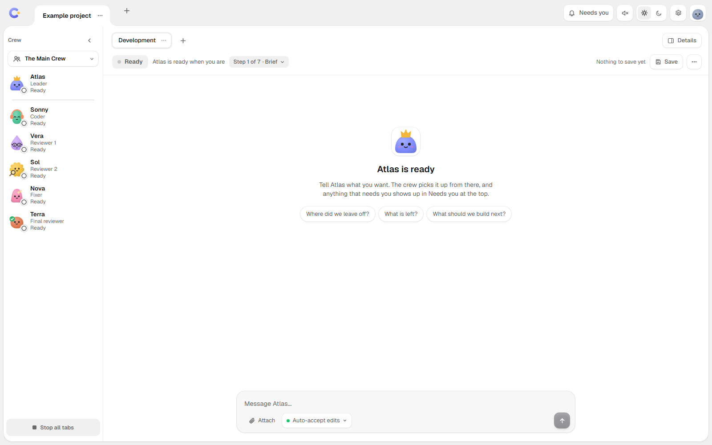

<div align="center">

# Command Center

**Run a crew of AI coding agents from one window.**
A leader plans, the crew builds and reviews, and you choose how much it may do without asking.




</div>

## What it is

Command Center is local mission control for the AI coding tools you already use. You talk to one **leader** (named Atlas by default). The leader plans the work and hands it to a **crew** of seats (coder, reviewers, fixer, final reviewer), each running on Claude Code, Codex or OpenCode. Everything runs on your own PC and talks only to the agent tools you have installed and signed in.

## Features

- **One leader, one crew per tab.** Projects hold tabs, and each tab owns its folder, crew, workflow and leader chat.
- **Any CLI in any seat.** The leader and every crew seat can run on Claude Code, Codex or OpenCode. Agent Client Protocol (ACP) CLIs can be added as a leader in Settings.
- **Ready-made workflows.** Development (Brief, Build, Gate, Your look, Review, Final review, Ship), Design and Marketing, with Main Crew, Duo and Stand-alone setups.
- **You stay in charge.** Approval cards for risky steps, permission modes per tab (Ask before edits, Auto-accept edits, Plan only, Bypass permissions) and a "Needs you" inbox.
- **Safety limits.** A launch budget, stall detection, leftover-process cleanup, and the app's own connection tokens kept out of the chat.
- **Live view.** Streaming chat, live run logs, usage and context numbers, Stop per tab or Stop all.
- **Pick up where you left off.** Save writes a handover file the next leader session reads.
- **Desktop or browser.** Run it as a desktop app or open it in your browser on localhost.

## Quick start

You need Windows, [Node 24](https://nodejs.org) or newer, and at least one of Claude Code, Codex or OpenCode installed and signed in.

```sh
# clone this repository, then in its folder:
npm install
npm run app      # desktop window
# or: npm start  # then open the printed http://127.0.0.1:4317/#key=... address
```

Build a portable exe with `npm run dist` (it still needs Node 24 on the machine).

## How it works

1. **Brief.** Tell the leader what you want. It writes the plan.
2. **Build.** The leader launches the coder seat in the tab folder.
3. **Gate.** The leader runs the checks.
4. **Your look.** You try it and approve, or ask for changes.
5. **Review.** Reviewer seats check the work; the fixer fixes what they find.
6. **Final review.** A fresh final reviewer checks the whole change.
7. **Ship.** The leader wraps up.

Each step shows who owns it, and anything that needs you lands in **Needs you**.

## Privacy and safety

- The server binds to `127.0.0.1` only. The live connection and every change need a per-launch key; loading the page and its images does not.
- No telemetry. Command Center sends nothing anywhere; the agent CLIs talk to their own providers as they normally do.
- Each tab picks a permission mode, from **Ask before edits** (the leader asks before edits, commands and launching seats that can write; a Codex leader asks only about commands Codex judges unsafe) to **Bypass permissions** (runs everything without asking). The mode picker says what each mode does for that tab's CLI. ACP leaders always run in full access.
- No CLI's read-only mode is treated as a real boundary.

See [SECURITY.md](./SECURITY.md) to report a problem.

## Contributing

Issues and pull requests are welcome. See [CONTRIBUTING.md](./CONTRIBUTING.md).

## Licence

MIT, see [LICENSE](./LICENSE).

Not affiliated with Anthropic, OpenAI or the other tools named. Their logos are trademarks of their owners.

---

# Reference

A workspace contains projects, each project contains tabs, and each tab owns its folder, crew, workflow process, runs, and leader conversation.

## Install & run

```sh
npm install
npm start
```

The server opens on `http://127.0.0.1:4317` and binds to localhost only. `npm start` prints one line, `Open http://127.0.0.1:4317/#key=<key>`: open that exact address, because the page needs the key to connect (every connection and every upload needs it; see `PROTOCOL.md` "App key"). To open the Electron desktop shell, run `npm run app`; Electron makes the key itself.

## Packaged .exe

`npm run dist` builds a portable exe in a per-run staging directory, checks that exact app/exe pair with `scripts/packaged-smoke.mjs`, then publishes the verified build. The smoke starts the exe without a window, waits for server readiness, requests `GET /`, and checks that the server and exe exit. It also runs the copied server with Node outside the repository to catch missing packaged imports.

For separate checks, build to a fresh output folder outside `dist/`. The exe must sit beside `win-unpacked`:

```sh
npx electron-builder --config.directories.output="<output>"
npm run dist:smoke -- "<output>/win-unpacked/resources/app" "<output>/Command Center.exe"
npm run dist:proof -- "<output>/win-unpacked/resources/app" "<output>/Command Center.exe"
```

The checks reject an app/exe pair from different builds and the published `dist/` pair. `npm run dist` removes its staging artifacts after verification. The smoke verifies startup, not whether the agent CLIs are installed. Builds are locked, and publication happens only after the staged build passes. A failed build quarantines its own exe and puts the last verified exe back over a current one that differs from it (if there is no last verified exe, the current one is left untouched); the next build removes that quarantined exe. A build that runs over 20 minutes or a smoke over 5 is stopped with all its child processes and counts as a failure.

The exe is not self-contained. It starts `node server/index.ts` as a child process, so Node 24 must be installed on the machine running it. `asar` is disabled because Node executes the packaged server from regular files under `resources/app/`.

The portable app unpacks to a fresh temp folder each launch, so packaged data lives under `%APPDATA%\command-center`. Electron passes that directory as `CC_DATA_DIR` only for packaged runs. Source runs keep config, logs, chats, and scratch files in the repository. On first packaged launch the app starts on one empty example project (`workspaces.json`, with a new empty `example-project` folder in the data root): the bundled `projects.json` is never copied to a user. No legacy `seats.json` is copied: nothing reads it. A `projects.json` the user already has in the data root still drives the first `workspaces.json`. Existing files are never overwritten.

## Workspaces and migration

The server reads and validates `config/workspaces.json`. The data model is:

```json
{
  "projects": [
    {
      "id": "my-project",
      "name": "My project",
      "folder": "C:/work/my-project",
      "tabs": [
        {
          "id": "my-project-development",
          "name": "Development",
          "kind": "dev",
          "process": "main",
          "folder": "C:/work/my-project",
          "crew": []
        }
      ]
    }
  ]
}
```

When that file is missing, the server builds it from the user's own `projects.json` in the data root if there is one (each old project becomes one Development tab using the `dev/main` slot defaults in `server/process.ts`), otherwise it starts the one-project example workspace. Old `seats.json` choices are not imported. Existing `projects.json`, `seats.json`, and `underground.json` files are left unchanged. An empty or unreadable `workspaces.json` (for example after a power cut) is kept beside itself as `workspaces.json.bad-<time>` and the example workspace is used; an unreadable `requests.json` is handled the same way and the request list starts empty.

Project IDs and tab IDs are lowercase slugs. Tab IDs must be unique across all projects. A seat key is `<tabId>.<slotId>` and is used for its logs and history. A run has a separate unique run ID, so one seat can have multiple active runs.

`CC_DATA_DIR` selects the packaged data root. Workspace config, launch safety, chat transcripts, scratch images, and run logs are stored below that root. Source runs use the repository root.

## Crew, processes, and permissions

Kind, process, slot, default CLI, model, effort, workflow steps, and write permission come from `server/process.ts`. The workspace file stores each slot's current name, CLI, model, effort, and optional picture. The server rejects unknown kinds/processes, unsafe or duplicate IDs, missing or extra crew slots and CLI mismatches when loading config. On load a model or effort only has to be safe in shape (a saved choice stays valid even if discovery does not list it); a write, or a pick in the app, must also be in the live lists.

For each worker run, the server reads `canWrite` from that tab's process slot and stores it with the run's CLI, model, effort, and folder. Claude receives `acceptEdits` for writable slots and plan mode plus named tool denials otherwise. Codex receives `workspace-write` or `read-only`, but a `codex exec --sandbox read-only` probe wrote a file on this PC, so no CLI's read-only mode is treated as a boundary. Read-only OpenCode runs receive edit and bash denials. Every Codex, Claude and OpenCode run counts as potentially writable for the stall monitor. The leader's launch approval asks only when the slot can write or the CLI is Codex (its read-only mode is not a boundary); a Claude or OpenCode seat in a read-only slot is launched without asking.

## Run logs and safety

Logs use `logs/<seatKey>-<timestamp>.log` and `.brief.txt`. The filename parser splits at the final `-<digits>`, so prior logs using bare seat IDs remain available from history.

The runner validates command inputs before using a shell, writes briefs to files instead of command arguments, strips the app's private data-root variables from child environments, and keeps an unconfirmed process visible until its real close or explicit release. Logs are flushed once when the process closes. When a worker run ends, any process it left running is stopped and the log says so (`[cleanup] stopped N processes`); after a server crash, the next start ends the processes the dead server was still watching (`logs/.children-<pid>.json`) before anything can launch. Kill, launch-budget, and uncertain-PID state is stored in `launch-safety.json`; old bare-ID entries remain in place. The launch budget is 4 launches per 5 minutes and counts every start, your own Run button included, not only the leader's; a refusal says how long until the next one is allowed. The file also lists runs that were started and not yet seen to end: after a hard crash their seats start blocked (nothing tracks those processes any more) until you allow launching again.

Stall tracking is keyed by run ID. No run is relaunched automatically any more: because no CLI's read-only mode proves a filesystem boundary, a stalled run of any CLI is marked stalled and escalated to the user instead of being repeated.

## Leaders and chat

Each tab gets its own leader when its first chat message arrives. The leader runs on whichever installed CLI its seat is set to: Claude (the Claude Agent SDK), Codex (`codex app-server`) or OpenCode (`opencode serve`), with the same crew tools, approvals, live chat and Stop on all three. Any seat can move to any installed CLI with `updateSeat`. Opening the app or sending `hello` does not start tab leaders. The leader runs in the tab folder. A Claude leader loads the user's `user`, `project`, and `local` setting sources, including `CLAUDE.md`, skills, plugins, and MCP configuration; Codex and OpenCode leaders load their own user configuration. The server makes one startup health check, for a Claude leader; it loads only the user's Claude settings and runs from the data root, never in a project folder. It is one paid model turn, so a pass is remembered and not repeated for the same model within 24 hours. Changing a tab's folder starts no leader either: the next chat message does, so a project's hooks never run unasked. `PROTOCOL.md` has the contract and the known limits (for example, Codex only asks about commands it does not consider safe, and the advisor is Claude-only).

Chat messages are appended as JSONL under `<data root>/chats/<tabId>.jsonl`. Revisions, saved revisions, messages, and clear events survive a server restart. Save requests are serialized per tab (one tab's Save never holds up another tab's), wait a bounded time for an active leader turn, then ask the leader to write `<tab folder>/.command-center/<tabId>/RESUME.md`. The server marks the current transcript revision saved only after that handover succeeds, and records that Save as a past session of the leader (the transcript at that moment and the handover path; the newest 50 are kept). Clear stops only that tab's leader immediately, clears its current transcript view, and makes the next fresh leader read that handover before replying.

The leader tools list and launch only crew in their own tab. They use the same run path and launch-safety budget as a client run.

## CLI discovery

At startup, the server asks Claude for its supported models and effort levels and asks OpenCode for its model list. Those calls run concurrently and do not block server readiness. A failed or timed-out query uses the built-in fallback and reports that fallback in state, so the UI can show that the list may be incomplete.

Codex has no supported-model enum to query. Its baseline list is `gpt-6-luna`, `gpt-6-sol`, and `gpt-6-astra`; discovered OpenCode `gpt-*` entries are also offered. A configured model already in a workspace stays available if a later discovery result omits it.

## Usage data

Claude Agent SDK results provide a Claude leader's latest input-side context estimate, context window, and cost. A Codex leader reports its last turn's input tokens and the model window (no cost); an OpenCode leader reports input and cache tokens, cost, and the model's context limit. The context estimate includes input and cache tokens, excludes output tokens, and is not true context occupancy. Each worker run has its own usage snapshot. Claude workers report usage and rate-limit events from stream JSON; Codex exposes only its final `tokens used` count; OpenCode does not report measured usage. Missing measurements remain absent rather than becoming zeroes. Usage is in-memory and session-scoped.

## Server protocol

The WebSocket state, events, and accepted client messages are documented in [PROTOCOL.md](./PROTOCOL.md). HTTP and WebSocket origin and host checks remain enabled. Pasted images are stored under the data root's `scratch/` directory and accepted into chat only from that directory.

## Development

```sh
npm test
npm start
```

